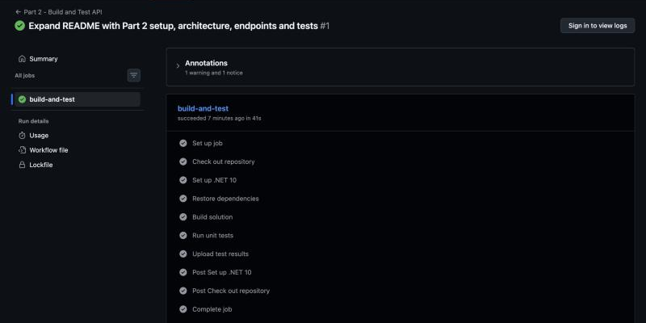
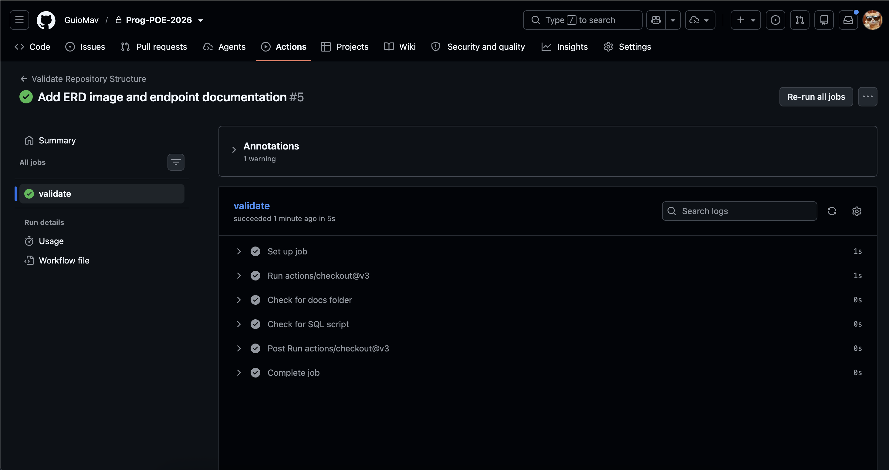

# Prog-POE-2026 / RaceDay

RaceDay is an event management platform for the South African road running, walking and
cycling community. Organisers create events, define age and distance categories, see who has
entered and capture results; participants browse events, enter by choosing a category and track
their personal race history.

| Part | Deliverable | Status |
|---|---|---|
| Part 1 | ERD, API endpoint plan, SQL database script (`/docs`) | Submitted, documents updated for Part 2 |
| **Part 2** | **ASP.NET Core Web API + EF Core + session auth + Swagger + unit tests + CI** | **This branch (`part-2`)** |
| Part 3 | MVC front end, Azure Blob Storage, Docker | Not started |

## User Roles

* **Organiser** (account type *Admin*) – creates, edits and deletes their own events, manages each
  event's age and distance categories (e.g. Under 20, Senior, 10km, 21km), views all enrolments
  for their events, and captures finish times and positions after an event.
* **Participant** (account type *Standard* or *Premium*) – registers an account, browses events,
  enters an event by selecting a category, views and cancels their own enrolments, and tracks their
  own results (position out of total finishers).

Both roles can view and update their own profile. Role-based access is enforced by the API on
every protected endpoint (401 when not logged in, 403 for the wrong role or someone else's data).

## Repository Structure

```
.github/workflows/
  validate.yml          Part 1 – checks /docs and the SQL script exist
  part2-api.yml         Part 2 – builds the solution and runs all tests on every push
docs/
  ERD Image.png         Part 1 ERD (original)
  ERD Part 2.png        Updated ERD matching the Code-First model
  ERD.md                Same ERD as a Mermaid diagram + relationship table
  Endpoint.docx         Part 1 endpoint plan (original)
  endpoint-plan.md      Endpoint plan matching the implemented API (+ changes from Part 1)
  raceday.sql           SQL Server script – schema identical to the EF model, with seed data
RaceDay.API/            ASP.NET Core Web API (.NET 10)
  Auth/                 Session helpers and the [SessionAuthorize] role filter
  Controllers/          Auth, Users, Events, Categories, Enrollments, Results
  Data/                 RaceDayDbContext, EF migrations, sample-data seeder
  Dtos/                 Request/response models with validation
  Models/               Entities: User, Organiser, Participant, Event, Category, Enrollment, Result
RaceDay.API.Tests/      xUnit tests (API tests + isolated unit tests)
RaceDay.sln
```

---

# Part 2 – RESTful API

## Technology

| Concern | Choice |
|---|---|
| Framework | ASP.NET Core Web API, C#, **.NET 10 (LTS)** |
| Data access | Entity Framework Core 10, **Code-First** with migrations, SQL Server |
| Authentication | **Server-side session** (`AddSession`) storing user id + role; HttpOnly cookie |
| Passwords | ASP.NET Core `PasswordHasher` (PBKDF2, salted) – only the hash is stored |
| API docs | Swagger / Swashbuckle with XML-comment descriptions for every endpoint |
| Tests | xUnit, `WebApplicationFactory` (in-memory API), EF Core InMemory provider |
| CI/CD | GitHub Actions – build + test on every push |

## How It Works

**Registration** creates a `Users` row (email, username, password hash, role, account type) plus
an `Organiser` or `Participant` row, depending on the role chosen. Organisers get the next
organiser number and are always *Admin*; participants choose *Standard* or *Premium*.

**Login** verifies the password hash and writes `UserId`, `Role` and `ProfileId`
(OrganiserId or ParticipantId) into the server-side session. The browser only holds the session
cookie, so later requests are identified by the session, not by data the client sends.

**Role enforcement** uses a custom filter, e.g. `[SessionAuthorize(UserRole.Organiser)]`:

* no user in the session → **401 Unauthorized**
* user's role not allowed → **403 Forbidden**

Controllers then check **ownership**: an organiser can only change their own events, categories
and results and see entries for their own events; a participant can only see their own enrolments
and results.

**Business rules** include: event dates cannot be in the past; a participant enters an event once,
choosing a category that belongs to that event; results can only be captured after the event, for
participants who entered, and each position is used once per event.

## Setup and Run

### Prerequisites

* [.NET 10 SDK](https://dotnet.microsoft.com/download/dotnet/10.0)
* SQL Server – **either** LocalDB (installed with Visual Studio on Windows) **or** SQL Server in Docker
* Visual Studio 2026 / VS Code / Rider (optional)

### 1. Clone and check out Part 2

```bash
git clone https://github.com/GuioMav/Prog-POE-2026.git
cd Prog-POE-2026
git checkout part-2
```

### 2. Choose a database

**Windows (Visual Studio + LocalDB)** – nothing to configure. The default connection string in
`RaceDay.API/appsettings.json` is:

```
Server=(localdb)\MSSQLLocalDB;Database=RaceDay;Trusted_Connection=True;TrustServerCertificate=True;MultipleActiveResultSets=True
```

**macOS / Linux (SQL Server in Docker)** – start SQL Server 2022:

```bash
docker run -d --name raceday-sql --platform linux/amd64 -e ACCEPT_EULA=Y -e "MSSQL_SA_PASSWORD=RaceDay!Dev2026" -p 1433:1433 mcr.microsoft.com/mssql/server:2022-latest
```

and point the API at it with an environment variable (no password is committed to the repo):

```bash
export ConnectionStrings__DefaultConnection="Server=localhost,1433;Database=RaceDay;User Id=sa;Password=RaceDay!Dev2026;TrustServerCertificate=True"
```

### 3. Run the API

```bash
dotnet run --project RaceDay.API --launch-profile https
```

or press **F5** in Visual Studio. On first start the API applies the EF Core migration (creating the
`RaceDay` database) and seeds sample data. Swagger opens at
**https://localhost:7105/swagger** (or http://localhost:5199/swagger with the `http` profile).

> Using SSMS instead? Run [`docs/raceday.sql`](docs/raceday.sql) first. It builds the same schema and
> marks the migration as applied, so the API uses that database as-is.

### 4. Try it in Swagger

1. Open `POST /api/auth/login` → **Try it out** → log in with a seeded account.
2. Call any protected endpoint – Swagger sends the session cookie automatically.
3. `POST /api/auth/logout` ends the session.

Seeded accounts (all use the password **`Password123!`**):

| Role | Email | Notes |
|---|---|---|
| Organiser | `david@example.com` | Spring City Athletics – owns events 1, 2 and 6 |
| Organiser | `emma@example.com` | Cape Trail Runners – owns events 3 and 5 |
| Organiser | `henry@example.com` | Winter Charity Trust – owns event 4 |
| Participant | `alice@example.com` | Has entries and results |
| Participant | `james@example.com` | Has entries, no results |

### 5. Run the tests

```bash
dotnet test RaceDay.sln
```

The tests host the real API in memory with an EF Core in-memory database, so no SQL Server is
needed.

## API Endpoints

All 28 endpoints are documented in [`docs/endpoint-plan.md`](docs/endpoint-plan.md) (method, route,
description, role, request body and success/failure responses) and can be tried in Swagger.

| Area | Endpoints |
|---|---|
| Authentication | `POST /api/auth/register`, `POST /api/auth/login`, `POST /api/auth/logout`, `GET /api/auth/me` |
| User profile | `GET/PUT /api/users/{id}` |
| Events | `GET /api/events`, `GET /api/events/upcoming`, `GET /api/events/{id}`, `POST /api/events`, `PUT/DELETE /api/events/{id}`, `GET /api/organisers/{organiserId}/events` |
| Categories | `GET/POST /api/events/{eventId}/categories`, `PUT/DELETE /api/categories/{id}` |
| Enrolments | `POST /api/enrollments`, `GET/PUT/DELETE /api/enrollments/{id}`, `GET /api/participants/{participantId}/enrollments`, `GET /api/events/{eventId}/enrollments` |
| Results | `GET /api/events/{eventId}/results`, `POST /api/results`, `PUT/DELETE /api/results/{id}`, `GET /api/participants/{participantId}/results` |

## Unit Tests

126 tests in `RaceDay.API.Tests`, all passing locally and in GitHub Actions.

| Test class | What it proves |
|---|---|
| `AuthTests` | Register both roles (201), password stored only as a hash, duplicate email/username (409), invalid input (400), login success starts a session, wrong password / unknown email (401), logout ends the session |
| `EventTests` | Organisers create/update/delete their own events (201/200/204), past dates and missing fields (400), another organiser's event (403), unknown id (404), public browsing and filters |
| `RoleAccessTests` | Every organiser-only endpoint rejects participants (403), every participant-only endpoint rejects organisers (403), every protected endpoint rejects anonymous calls (401), public endpoints stay open |
| `EnrollmentTests` | A participant enrols by category and the participant, event, category, price and date are recorded; duplicates (409), wrong category or past event (400), organisers see entries only for their own events, status rules per role, withdraw |
| `CategoryTests` | Age/distance categories, duplicate names (409), ownership (403), cannot delete a category with entries (409) |
| `ResultTests` | Results only after the event and for entered participants, duplicate positions (409), participant history with position out of total finishers |
| `ProfileTests` | Both roles view/update their own profile, other users' profiles (403), email in use (409) |
| `SessionAuthorizeAttributeTests` | The role filter in isolation: 401 / 403 / allowed |
| `RequestValidationTests` | Validation rules on registration, events and results |

## CI/CD

[`.github/workflows/part2-api.yml`](.github/workflows/part2-api.yml) runs on every push and pull
request: restore → build (Release) → run all tests → upload the test results.

<!-- TODO: replace with a screenshot of the green Part 2 build after pushing the part-2 branch -->


## Changes to the Part 1 Design

Part 2 requires a few things the Part 1 design did not have, so the ERD, SQL script and endpoint
plan in `/docs` were updated (the originals are kept for comparison):

| Change | Why |
|---|---|
| `Users.PasswordHash`, `Users.CreatedAt` | Login with hashed passwords is required. |
| `Organiser.OrganisationName`, `Participant.DateOfBirth` | Personal details at registration; date of birth supports age categories. |
| `Events.DistanceKm`, `Events.EventType` (Run/Walk/Cycle), `Events.EntryFee` | Each event must capture distance and type; the fee becomes the enrolment price. |
| `Category.CategoryType` (Age/Distance), unique name per event | Categories can be age- or distance-based. |
| `Enrollment.CategoryId` | Enrolments must record the category the participant selected. |
| Unique `(EventId, Position)` on `Result`, check constraints on distance, fee, price and position | Prevents impossible data (shared positions, negative values). |
| All primary keys are `IDENTITY` | Part 1 only auto-generated `Users`; the API needs the database to generate ids. |
| `USE RaceDay` added to the script | The Part 1 script created tables in `master`. |
| Sample events 4 and 5 renamed *Winter Charity Walk* and *Cape Fitness Ride* | So the seed data contains all three event types. |

## Video Walkthrough

* Part 1: [YouTube – planning, ERD, endpoint plan and SQL script](https://youtu.be/wno92xTGZuY)
* Part 2: <!-- TODO: add the unlisted YouTube link for the Part 2 demo --> *link to be added*

---

# Part 1 – Planning and Database

The Part 1 submission (ERD, endpoint plan and SQL script) lives in `/docs`. A GitHub Actions
workflow ([`validate.yml`](.github/workflows/validate.yml)) checks that the `/docs` folder and SQL
script exist.



Original Part 1 ERD:


Updated ERD for Part 2:


---

## AI Usage Disclosure

<!-- Review and adjust this statement so it accurately describes how you used AI. -->
An AI coding assistant (Claude) was used during Part 2 to help scaffold and write code, tests and
documentation. All work was reviewed, run and tested by me, and I can explain the design and code.
