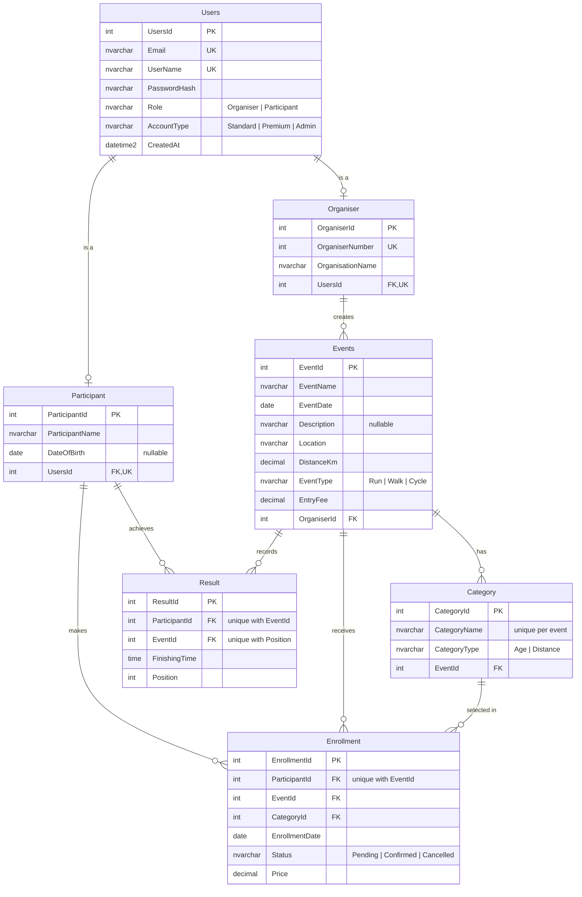

# RaceDay ERD (Part 2)

This ERD reflects the schema built by the EF Core Code-First model in `RaceDay.API` and by
[`raceday.sql`](raceday.sql). A PNG copy is in [`ERD Part 2.png`](ERD%20Part%202.png); the
original Part 1 diagram is kept as [`ERD Image.png`](ERD%20Image.png) for comparison.

## Relationships

| Relationship | Cardinality | Notes |
|---|---|---|
| Users – Organiser | 1 to 0..1 | Each organiser profile belongs to exactly one user (unique `UsersId`). |
| Users – Participant | 1 to 0..1 | Each participant profile belongs to exactly one user (unique `UsersId`). |
| Organiser – Events | 1 to many | An organiser creates many events. |
| Events – Category | 1 to many | Categories are deleted with their event. |
| Participant – Enrollment | 1 to many | A participant can enter many events, once per event. |
| Events – Enrollment | 1 to many | |
| Category – Enrollment | 1 to many | The category the participant chose when entering. |
| Participant – Result | 1 to many | One result per participant per event. |
| Events – Result | 1 to many | Each finishing position is used once per event. |

Participant and Events form a **many-to-many** relationship through `Enrollment` (entries) and
through `Result` (finishers).
